<picture>
  <source media="(prefers-color-scheme: dark)" srcset="assets/branding/logo-light.svg">
  
</picture>

Темы оформления для конфигуратора 1С.

## Возможности

- 13 светлых и тёмных пресетов и стандартное оформление.
- Подключение к уже открытым и новым конфигураторам.
- Переключение тем без перезапуска после загрузки совместимой версии движка.
- Сохранение пользовательских настроек, работа в трее и добровольный автозапуск.
- Графический интерфейс и отдельный CLI.

Автозапуск включается в интерфейсе и запускает приложение в фоне.

## Скриншоты


### v8-chroma

| Коллекция тем и предпросмотр | Настройки в отдельном профиле |
|---|---|
| [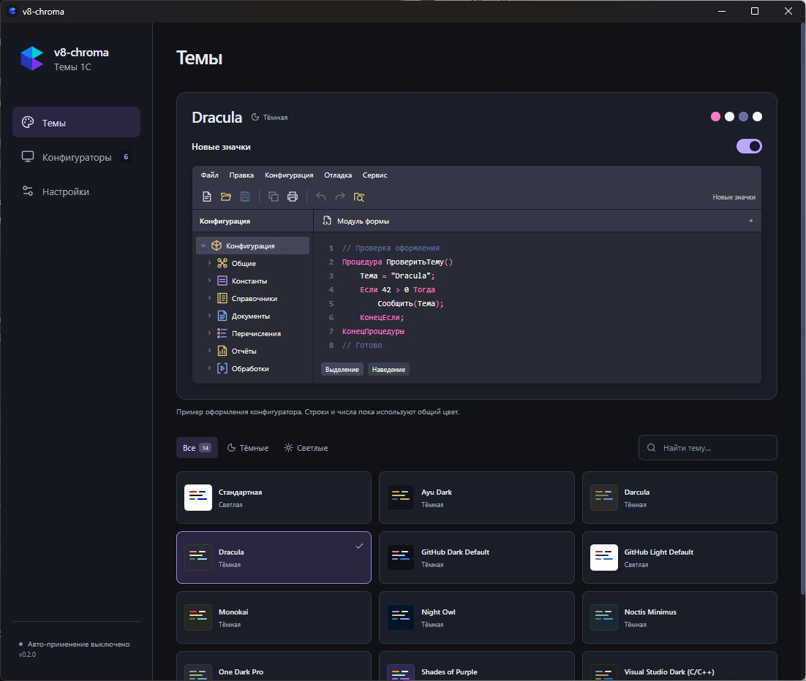](assets/screenshots/app-themes.jpg) | [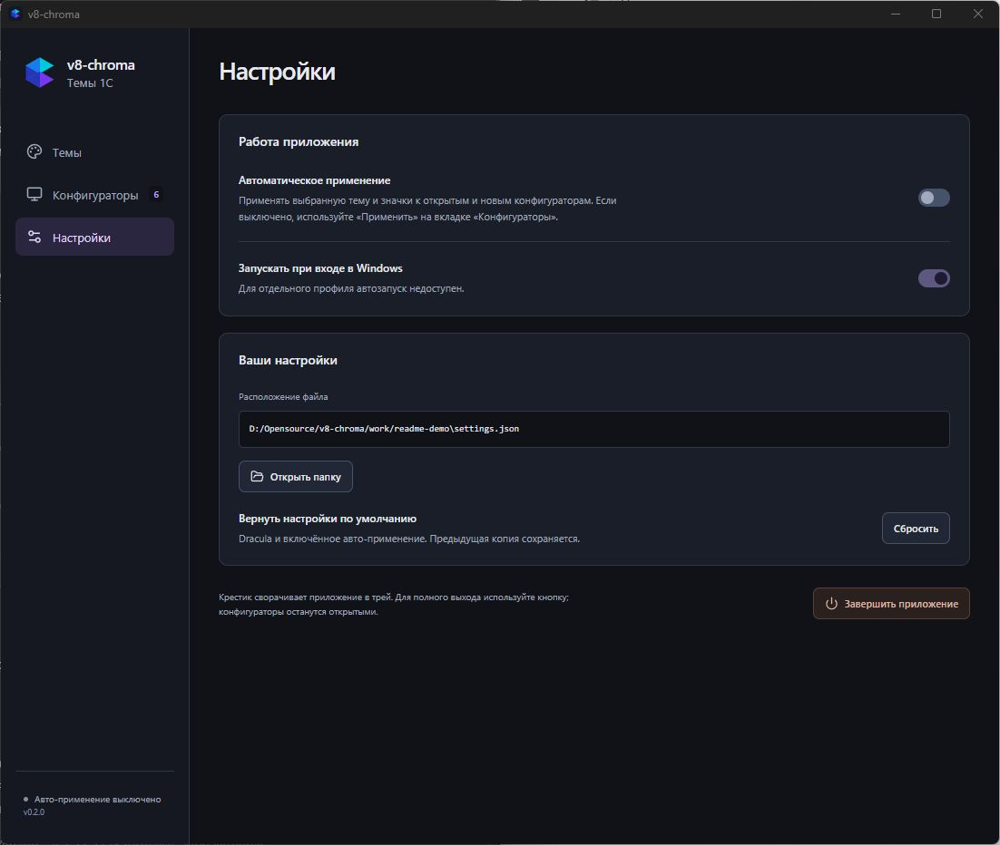](assets/screenshots/app-settings.jpg) |

### Конфигуратор

| Ayu Dark | Darcula | Dracula |
|---|---|---|
| [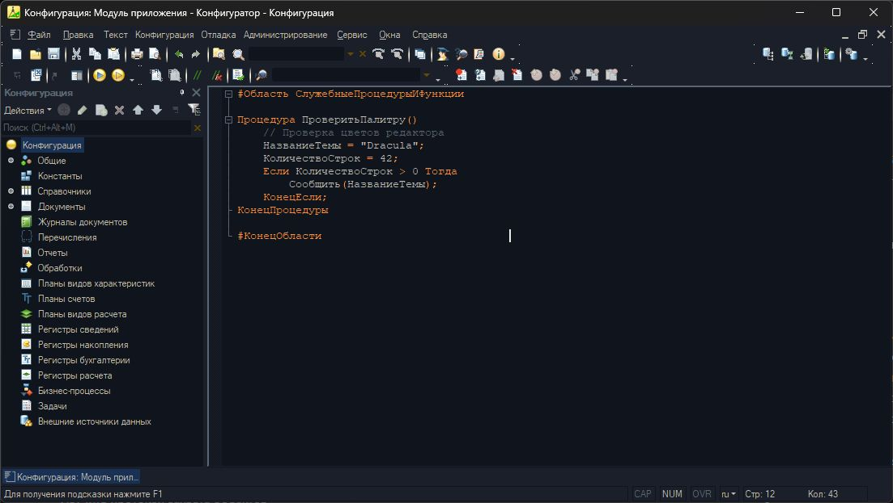](assets/screenshots/configurator-ayu-dark.jpg) | [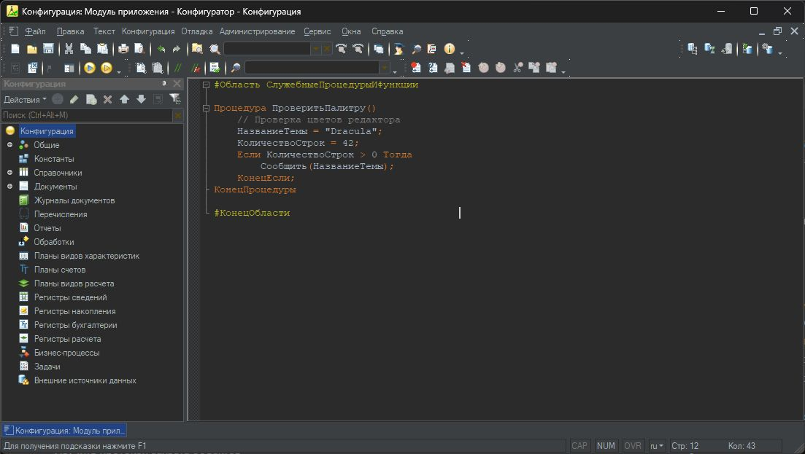](assets/screenshots/configurator-darcula.jpg) | [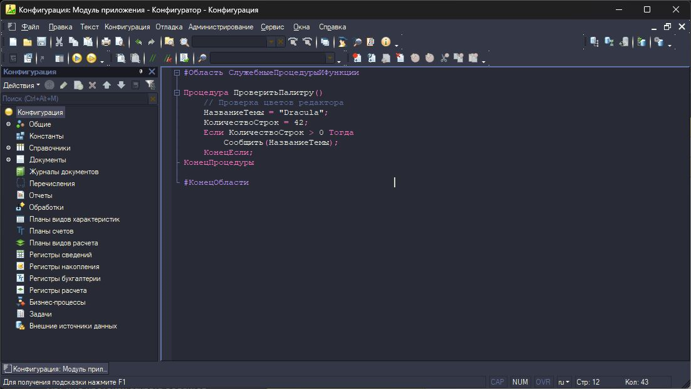](assets/screenshots/configurator-dracula.jpg) |
| **GitHub Dark Default** | **GitHub Light Default** | **Monokai** |
| [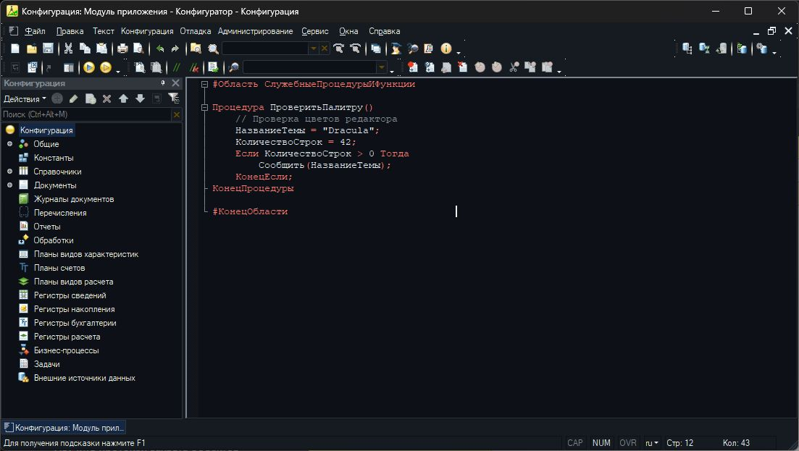](assets/screenshots/configurator-github-dark-default.jpg) | [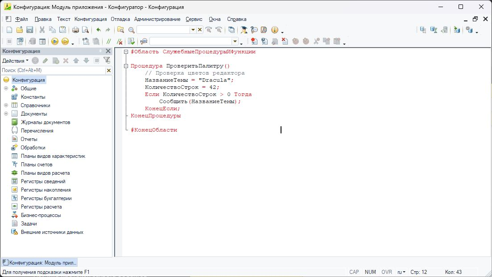](assets/screenshots/configurator-github-light-default.jpg) | [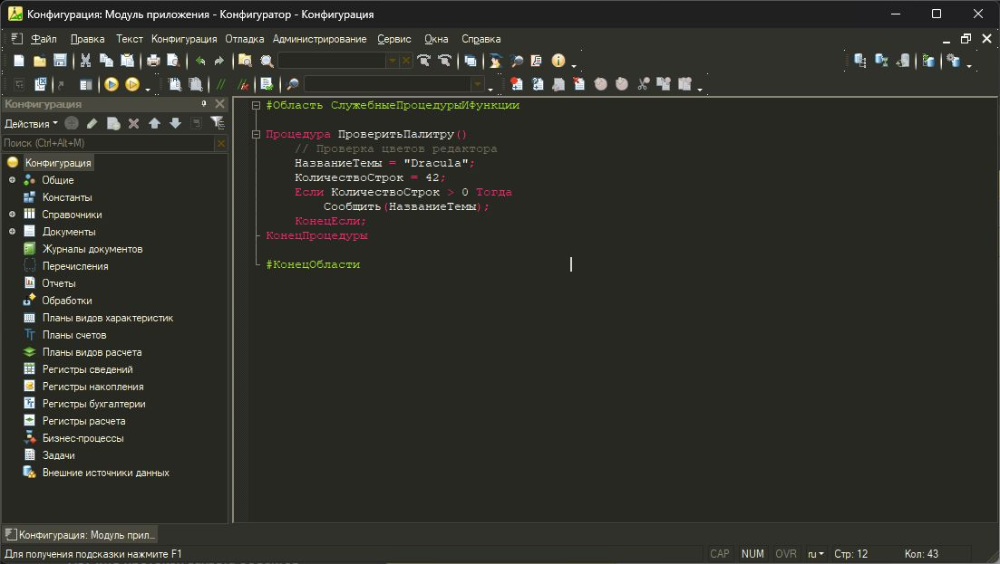](assets/screenshots/configurator-monokai.jpg) |
| **Night Owl** | **Noctis Minimus** | **One Dark Pro** |
| [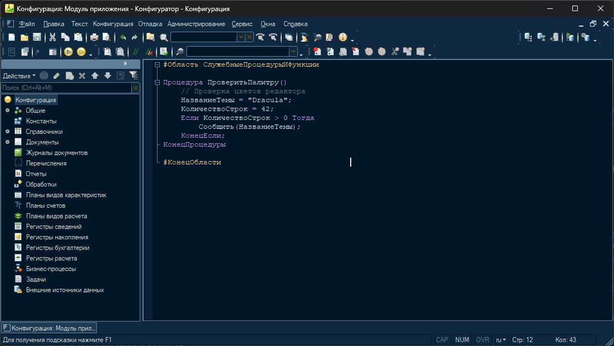](assets/screenshots/configurator-night-owl.jpg) | [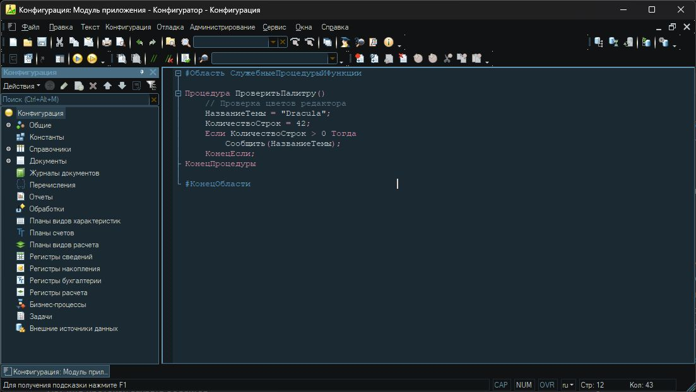](assets/screenshots/configurator-noctis-minimus.jpg) | [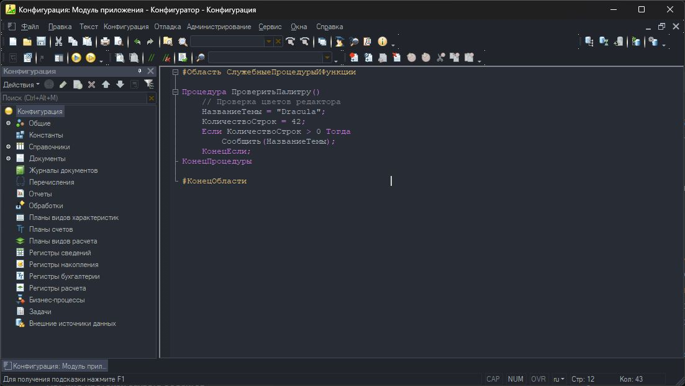](assets/screenshots/configurator-one-dark-pro.jpg) |
| **Shades of Purple** | **Visual Studio Dark (C/C++)** | **Visual Studio Light Modern** |
| [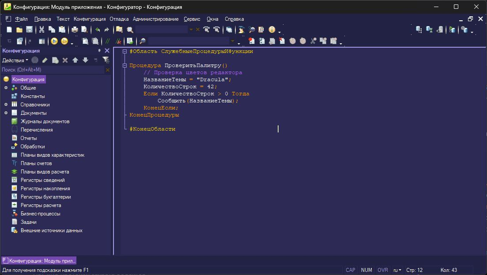](assets/screenshots/configurator-shades-of-purple.jpg) | [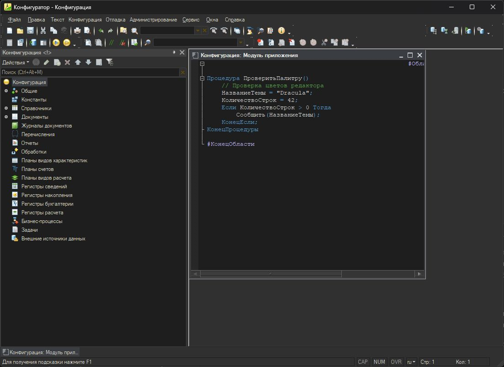](assets/screenshots/configurator-visual-studio-dark.jpg) | [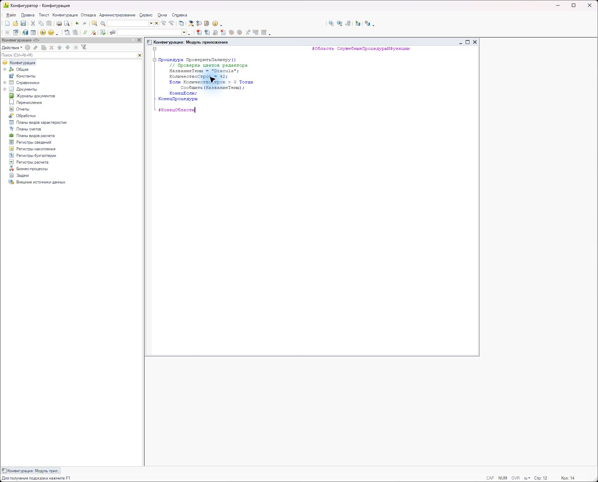](assets/screenshots/configurator-visual-studio-light.jpg) |
| **Winter is Coming (Dark Blue)** | **Стандартная** | |
| [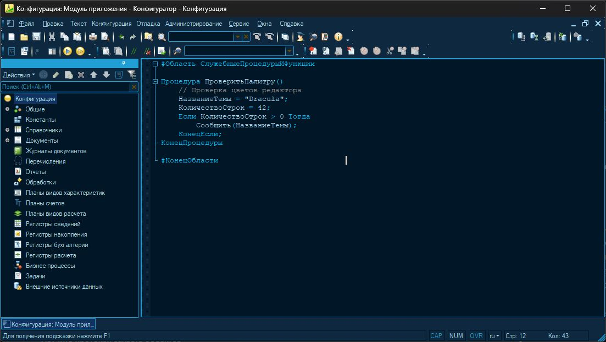](assets/screenshots/configurator-winter-is-coming-dark-blue.jpg) | [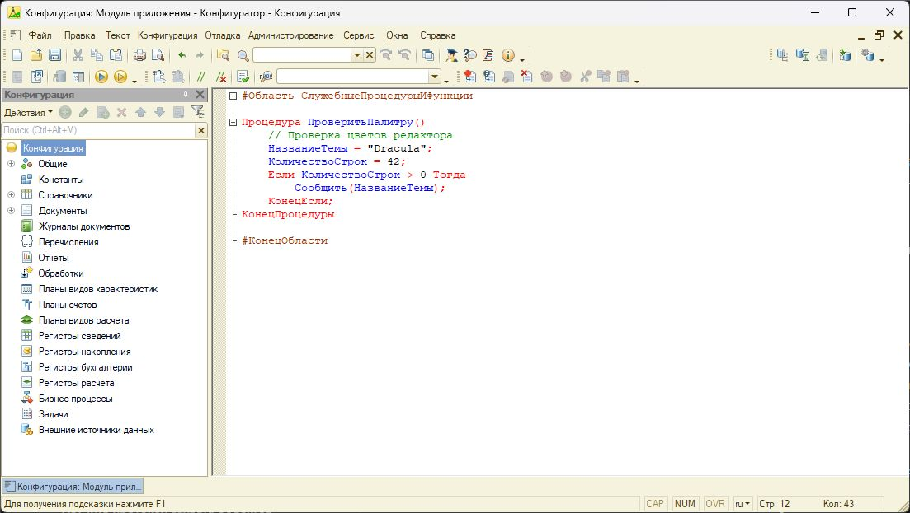](assets/screenshots/configurator-standard.jpg) | |

## Требования и совместимость

Windows x64, установленная платформа 1С и Microsoft Edge WebView2 Runtime.
Основная проверенная платформа — 8.3.27.2325 x64. Другие версии требуют отдельной
проверки: обнаружение процесса само по себе не подтверждает корректность оформления.

Движок загружается в процесс конфигуратора и перехватывает вызовы отрисовки.
Файлы платформы на диске не изменяются. При обновлении самого движка уже открытый
конфигуратор может потребовать одного штатного перезапуска.

## Установка и запуск

Скачайте `v8-chroma.exe` со
[страницы Releases](https://github.com/APonkratov/v8-chroma/releases), поместите
в постоянный каталог и запустите. Для CLI отдельно доступен `v8-chroma-cli.exe`.
ZIP и установка DLL рядом с EXE для работы не требуются: движок встроен и
извлекается в пользовательский каталог.

WebView2 Runtime для GUI нужен отдельно; при его отсутствии установите
[Evergreen Runtime от Microsoft](https://developer.microsoft.com/en-us/microsoft-edge/webview2/).

Выберите тему в интерфейсе. По умолчанию Dracula автоматически применяется
к подходящим конфигураторам. Автоматическое применение можно выключить; закрытие
окна сворачивает приложение в трей. Для завершения используйте команду выхода
в настройках или меню трея. Чтобы вернуть обычное оформление, сначала примените «Стандартную»
тему. Завершение менеджера само по себе не выгружает движок из конфигуратора.

Автозапуск опциональный. После перемещения EXE выключите и снова включите его
в настройках, чтобы обновить путь.

## Темы

- Ayu Dark
- Darcula
- Dracula
- GitHub Dark Default
- GitHub Light Default
- Monokai
- Night Owl
- Noctis Minimus
- One Dark Pro
- Shades of Purple
- Visual Studio Dark (C/C++)
- Visual Studio Light Modern
- Winter Is Coming Dark Blue

Цвета адаптированы к отрисовке 1С. Отдельные категории, например строки и числа, могут использовать общий цвет.
В разрабатываемой версии на вкладке «Темы» доступен переключатель «Новые значки»
(по умолчанию выключен). Превью показывает панель, дерево и модуль выбранного
оформления. Панели, дерево и меню получают тонкие
контурные значки; светлый/тёмный набор выбирается по теме. Выключение возвращает
штатную графику без перезапуска. Выбор темы и переключение значков сразу сохраняются,
обновляют превью и применяются к открытым конфигураторам даже при выключенном
авто-применении. Повторное применение доступно на вкладке «Конфигураторы». Проверенный профиль —
8.3.27.2325 x64; незнакомые изображения, значки заголовков и вкладок остаются штатными.
[Устройство и проверки](docs/icon-integration.md).

## CLI

```powershell
./v8-chroma-cli.exe themes
./v8-chroma-cli.exe list
./v8-chroma-cli.exe settings show
./v8-chroma-cli.exe settings set --theme dracula --auto-apply off
./v8-chroma-cli.exe attach --pid 12345
./v8-chroma-cli.exe watch
```

`12345` замените PID конфигуратора из `list`. CLI и GUI используют общие
настройки; `--config-dir '<directory>'` создаёт отдельный профиль настроек.
Без подкоманды CLI наблюдает за процессами, как `watch`.

## Разработка

Стек: Rust, Tauri 2, Svelte 5 и нативный C++ движок.
Сборкой C++ управляют CMake/Ninja, Rust — Cargo; общие команды проверок и выпуска
написаны на Python. Ядро проверяется для x64/ARM64 на трёх ОС; поддержка
подключения и поставка приложения ограничены Windows x64.

- [Устройство проекта и локальные проверки](docs/development.md).
- [Платформы и границы переносимости](docs/portability.md).
- [Порядок выпуска](docs/releasing.md).
- [История изменений](CHANGELOG.md).
- [Логотип и иконки](assets/branding/README.md).

GitHub Actions выполняет проверки PR и сборку EXE по stable/RC-тегам.
Локальные команды предназначены для разработки и проверок.

## Благодарности

Спасибо автору [статьи о смене оформления конфигуратора на Инфостарте](https://infostart.ru/1c/tools/2823573/)
за идею, которая вдохновила создание v8-chroma.

## Лицензии

Собственный код распространяется под [MIT](LICENSE).
Источники палитр и уведомления их авторов сохранены в
[THIRD-PARTY-NOTICES](assets/THIRD-PARTY-NOTICES.txt).
Зависимости и порядок формирования уведомлений описаны в [licenses/README](licenses/README.md).

v8-chroma — независимый проект; он не является продуктом фирмы «1С».
