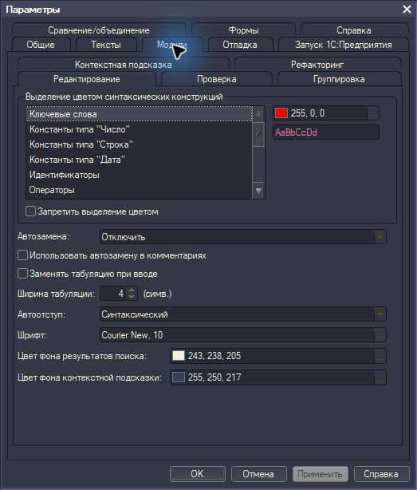

<picture>
  <source media="(prefers-color-scheme: dark)" srcset="assets/branding/logo-light.svg">
  
</picture>

Темы оформления для конфигуратора 1С.

## Возможности

- 13 светлых и тёмных пресетов и стандартное оформление.
- Подключение к уже открытым и новым конфигураторам.
- Переключение тем без перезапуска после загрузки совместимой версии движка.
- Сохранение пользовательских настроек, работа в трее и добровольный автозапуск.
- Графический интерфейс и отдельный CLI.

Автозапуск включается в интерфейсе и запускает приложение в фоне.

## Скриншоты

| Dracula | Visual Studio Dark (C/C++) | Visual Studio Light Modern |
|---|---|---|
| [](assets/screenshots/configurator-dracula.jpg) | [](assets/screenshots/configurator-visual-studio-dark.jpg) | [](assets/screenshots/configurator-visual-studio-light.jpg) |

<details>
  <summary>Сервис → Параметры в теме Dracula</summary>



</details>

## Требования и совместимость

Windows x64, установленная платформа 1С и Microsoft Edge WebView2 Runtime.
Основная проверенная платформа — 8.3.27.2325 x64. Другие версии требуют отдельной
проверки: обнаружение процесса само по себе не подтверждает корректность оформления.

Движок загружается в процесс конфигуратора и перехватывает вызовы отрисовки.
Файлы платформы на диске не изменяются. При обновлении самого движка уже открытый
конфигуратор может потребовать одного штатного перезапуска.

Кроссплатформенный UI Tauri не означает поддержку перекраски на Linux или macOS.

## Установка и запуск

Скачайте `v8-chroma.exe` со
[страницы Releases](https://github.com/APonkratov/v8-chroma/releases), поместите
в постоянный каталог и запустите. Для CLI отдельно доступен `v8-chroma-cli.exe`.
ZIP и установка DLL рядом с EXE для работы не требуются: движок встроен и
извлекается в пользовательский каталог.

Сверьте результат со строкой EXE в SHA256SUMS.txt. WebView2 Runtime для GUI
нужен отдельно; при его отсутствии установите
[Evergreen Runtime от Microsoft](https://developer.microsoft.com/en-us/microsoft-edge/webview2/).

Выберите тему в интерфейсе. По умолчанию Dracula автоматически применяется
к подходящим конфигураторам. Автоматическое применение можно выключить; закрытие
окна сворачивает приложение в трей. Для завершения используйте команду выхода
в настройках или меню трея. Чтобы вернуть обычное оформление, сначала примените «Стандартную»
тему. Завершение менеджера само по себе не выгружает движок из конфигуратора.

Автозапуск добровольный. После перемещения EXE выключите и снова включите его
в настройках, чтобы обновить путь.

## Темы

- Ayu Dark
- Darcula
- Dracula
- GitHub Dark Default
- GitHub Light Default
- Monokai
- Night Owl
- Noctis Minimus
- One Dark Pro
- Shades of Purple
- Visual Studio Dark (C/C++)
- Visual Studio Light Modern
- Winter Is Coming Dark Blue

Цвета адаптированы к отрисовке 1С. Отдельные категории, например строки и числа, могут использовать общий цвет.
Некоторые штатные значки и мелкие элементы сохраняют исходные пиксели.

## CLI

```powershell
./v8-chroma-cli.exe themes
./v8-chroma-cli.exe list
./v8-chroma-cli.exe settings show
./v8-chroma-cli.exe settings set --theme dracula --auto-apply off
./v8-chroma-cli.exe attach --pid 12345
./v8-chroma-cli.exe watch
```

`12345` замените PID конфигуратора из `list`. CLI и GUI используют общие
настройки; `--config-dir '<directory>'` создаёт отдельный профиль настроек.
Без подкоманды CLI наблюдает за процессами, как `watch`.

## Разработка

Стек: Rust, Tauri 2, Svelte 5 и нативный C++ движок.
Сборкой C++ управляют CMake/Ninja, Rust — Cargo; общие команды проверок и выпуска
написаны на Python. Ядро проверяется для x64/ARM64 на трёх ОС; поддержка
подключения и поставка приложения ограничены Windows x64.

- [Устройство проекта и локальные проверки](docs/development.md).
- [Платформы и границы переносимости](docs/portability.md).
- [Порядок выпуска](docs/releasing.md).
- [История изменений](CHANGELOG.md).
- [Логотип и иконки](assets/branding/README.md).

GitHub Actions выполняет проверки PR и сборку EXE по stable/RC-тегам.
Локальные команды предназначены для разработки и проверок.

## Благодарности

Спасибо автору [статьи о смене оформления конфигуратора на Инфостарте](https://infostart.ru/1c/tools/2823573/)
за идею, которая вдохновила создание v8-chroma.
Авторам EDT Themes и исходных цветовых схем — за палитры, адаптированные для конфигуратора.

## Лицензии

Собственный код распространяется под [MIT](LICENSE).
Источники палитр и уведомления их авторов сохранены в
[THIRD-PARTY-NOTICES](assets/THIRD-PARTY-NOTICES.txt).
Зависимости и порядок формирования уведомлений описаны в [licenses/README](licenses/README.md).

v8-chroma — независимый проект; он не является продуктом фирмы «1С».
