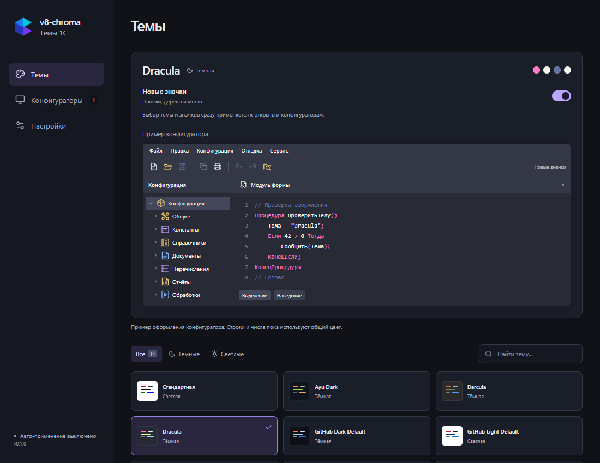
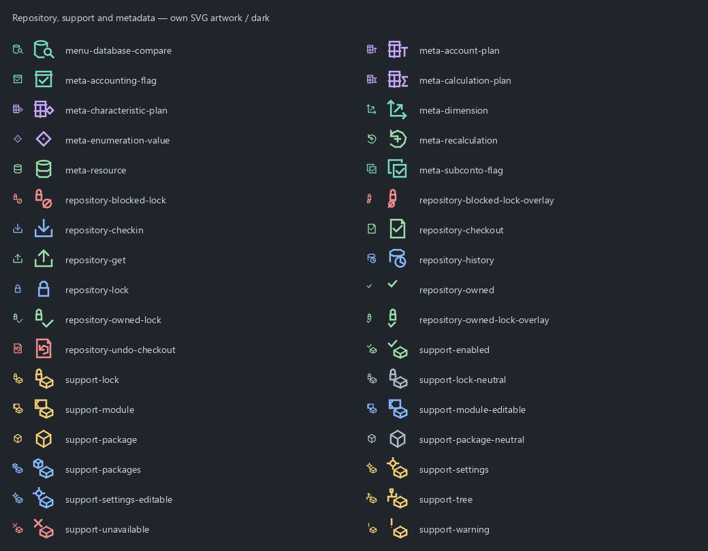
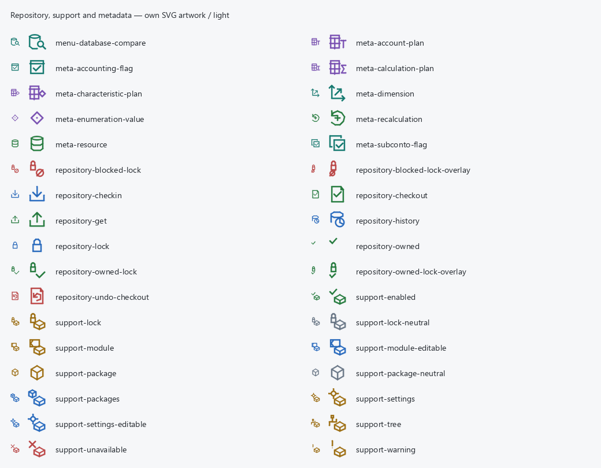

# Собственные значки

GUI и CLI поставляют одну ThemeProbe.dll, отвечающую за тему и значки.

На вкладке «Темы» находится единственный переключатель «Новые значки»,
по умолчанию выключенный. Светлый/тёмный набор выбирается по теме, «Стандартная» использует
светлые значки без перекрашивания интерфейса. Выключение возвращает штатную
графику без перезапуска. Выбор темы и переключение значков сразу сохраняются,
обновляют превью. Авто-применение управляет отправкой выбранной темы и значков
в открытые и новые подходящие конфигураторы. Если открытых конфигураторов нет,
выбор сохраняется. При выключенном авто-применении оформление конфигуратора
не меняется; сохранённый выбор можно применить на вкладке
«Конфигураторы» к выбранному процессу или ко всем подходящим.
Диагностический CLI-пресет `diagnostic` всегда отключает подмену.

Вкладка показывает пример панели команд, дерева и модуля выбранной темы.
Превью всегда отражает выбранное оформление: отдельного сравнения и кнопки
применения здесь нет. После выбора темы пример возвращается в видимую область.
На общей странице «Настройки» дублирующего переключателя нет.

Текущий найденный фрагмент в редакторе модуля использует фон выделения темы.
Контраст обычного и выделенного текста с этим фоном проверяется для всех тем;
одноимённый цвет RGB-заливок интерфейса сохраняет роль панели.



Новые значки превью используют те же собственные SVG-мастера, что и движок.
Штатные примеры — фрагменты уже сохранённых обезличенных скриншотов конфигуратора
для каждой темы; извлечённые PNG ресурсов платформы в UI не добавляются.

```powershell
v8-chroma-cli --config-dir '<profile>' settings set --custom-icons on
v8-chroma-cli --config-dir '<profile>' attach --pid <test-designer-pid>
```

Исходные отпечатки собраны на 8.3.27.2325 Windows x64. Номер версии платформы
не ограничивает подмену: нужны совместимые Cairo API и импорты, а каждое
изображение проверяется по точному совпадению содержимого и размеров поверхности.
Для трёх кнопок цвета панели форматирования
сравнивается известный рисунок 16×12; нижние четыре строки 16×16 поверхности —
изменяемый индикатор выбранного цвета — сохраняются без преобразования.
Ключ кэша включает всю исходную поверхность, поэтому смена цвета обновляет индикатор.
Незнакомые изображения, заголовки/вкладки,
принтерные/PDF/SVG назначения остаются штатными. При недоступности Cairo API или
трёх необязательных импортов тема работает, а GUI/CLI показывают причину отказа.
Ошибка подготовки значков при первом подключении также оставляет цветовую тему
активной: откатываются только перехваты значков, сохраняется код ошибки.

`scripts/build_icon_assets.py` генерирует встроенные RLE-пиксели из собственных
SVG и профилей отпечатков: 538 ручных состояний и 814 записей атласов/фрагментов.
SVG-мастера в `assets/toolbar-icons/light/` и `dark/` — единственный источник
рисунков. `scripts/icon_raster.py` выполняет их растеризацию.
Установленная 1С/Cairo для сборки не нужна. Python и Pillow нужны только для
сборки; оригинальная графика и диагностические изображения не поставляются.
Чтения/записи файлов в callback отрисовки нет. Кэш ограничен 1024 записями и
16 MiB пикселей; неизвестные поверхности его не заполняют. Смена набора
освобождает кэш с учётом выполняющихся вызовов и ссылок Cairo.

Профиль `repository-8.3.27.json` дополняет команды захвата, помещения, отмены
захвата, получения, истории и сравнения объекта с хранилищем. Значки замков
различают обычную блокировку, захват с отметкой и запрет; сохраняется расположение
отметок в составных состояниях. Значки поддержки различают пакет поставщика,
нейтральный пакет, замок, модуль, настройку и отметки состояния. Для обоих наборов
добавлены 23 SVG-мастера. Профили включают отдельные изображения и известные
атласы, в том числе варианты округления premultiplied BGRA платформой: именно
такой вариант замка был подтверждён в работающем конфигураторе. Неизвестные
изображения по-прежнему остаются без изменений.

Для этих ресурсов отдельно проверены 66 исходных поверхностей в production-модуле
значков: оба набора, вызовы source/mask/mask-surface, сохранение исходных пикселей
и остальных ячеек атласа, пропуск изменённого неизвестного изображения и отключение.
Исходные пиксели платформы использовались только как локальные диагностические
данные и в репозиторий не включены. Живая проверка всех новых состояний поддержки
и меню хранилища остаётся отдельной проверкой в конфигураторе.

Профиль дерева дополнен значениями перечислений, объектами планов видов
характеристик, счетов и видов расчёта, признаками учёта и учёта субконто,
измерениями, ресурсами и перерасчётами. Объекты планов используют тот же стиль,
что и их группы; для остальных узлов добавлены шесть SVG-мастеров на каждый
набор. Значения перечислений учитываются также в атласе шириной 727 пикселей
с неполной последней ячейкой. Дополнительные 32 исходные поверхности проверены
в обоих наборах через source/mask/mask-surface, с сохранением остальных пикселей
и пропуском неизвестных изображений. Оригиналы остаются локальными данными QA.

Превью собственных SVG (16 и 32 px; без данных конфигурации):




Панель форматирования использует собственные значки начертания, цвета фона,
текста и линии, а также четырёх вариантов выравнивания. Образцы линии и узора,
список шрифтов и размер отображают выбранные значения средствами платформы.

Редактор табличного документа использует 37 дополнительных SVG-мастеров для
каждого набора. Профиль `sheet-8.3.27.json` покрывает команды выравнивания,
размеров, группировки, объединения ячеек, сетки, заголовков, фиксации, имён и
примечаний, а также подготовленные неактивные состояния. Маски команд различимы
по alpha. Значок документа подготовлен в размерах 14 и 16 px; системный значок
MDI-окна пока остаётся штатным. Подробности и границы проверки описаны в
[отчёте по макетам](mxl-rendering-followup.md).

Порядок блокировок: `lifecycleLock → themeLock → icon stateLock`; callback берёт
только две последние. Набор готовится до изменения активной конфигурации:
при ошибке подготовки сохраняется прежнее оформление. `ThemeStop` терминален;
переключатель значков его не вызывает и допускает повторное включение.

ABI v3 имеет размер 4760 байт, поля `iconMode` (0/1/2) и `iconPack` (0/1).
Snapshot отдельно подтверждает основные/необязательные перехваты и режим набора.
Сессия использует схему 2; applied marker включает всю конфигурацию и поколение.
Watcher учитывает тему и значки, а изменение геометрии GUI не запускает применение.
Настройки схемы 1 мигрируют с точной резервной копией, `custom_icons=false`;
прежняя стандартная тема `diagnostic` становится `standard`. Неизвестные схемы
не перезаписываются. Старую DLL в уже открытой 1С нужно обновлять штатным
перезапуском: проверки идентичности процесса, пути и SHA-256 сохранены.

Проверки: native fixture без 1С (восемь размеров, A8/ARGB, alpha/матрицы,
изменяемый источник, динамические индикаторы цвета, отказ подготовки, переключение при параллельной отрисовке,
освобождение кэша), воспроизводимость пакета, 17 независимых goldens,
миграция/backup, CLI, watcher и отказ неподдерживаемого host. Дополнительная
регрессия production IAT на установленном настоящем Cairo прошла.
`icon_bootstrap_test` вызывает production `ThemeInitialize` с принудительным
отказом компонента значков для обоих наборов и проверяет штатные импорты значков,
сохранение цветовых перехватов, диагностический snapshot, смену темы и остановку.

Полная живая матрица DPI 100/125/150/200%, длительное наблюдение и smoke
официальных релизных EXE остаются проверками перед выпуском.

Превью проверено в production-сборке frontend через Playwright с тестовым IPC:
каждое изменение вызывает одну команду `set_appearance`, без отдельного save/apply;
выключенное авто-применение сохраняется, отсутствие процессов не блокирует выбор,
ошибка не меняет сохранённое превью, во время применения элементы заблокированы.
Все 16 SVG примера загружаются, на ширине 640 px нет переполнения страницы.
Backend-тесты проверяют сохранение и обновление превью без применения при
выключенном флаге, однократное применение через наблюдатель при включённом,
применение последнего выбора после включения флага, отдельную ручную команду
и обработку отказов.
Рабочие конфигураторы для этих UI-проверок не затрагивались.

Окно сравнения использует дополнительные тонкие значки процедур, функций,
областей, расширения и заимствования, блокировки, поиска неразрешимых ссылок,
объединения модулей и обновления. Профиль `comparison-8.3.27.json` содержит
отдельные изображения и подготовленные платформой варианты; записи атласов
сохраняют остальные фрагменты исходной поверхности.

Изменённые блоки кода (`cairo-rgb.F5F5F5`) получают фон `compare.changed`,
совпадающий с цветом изменённых строк и легенды. Неизменённый код сохраняет
фон редактора. Одноимённая RGBA-заливка элементов интерфейса остаётся панелью.
Контраст текста проверяется во всех 13 темах; production IAT с настоящим Cairo
проверяет обе API-формы и восстановление исходного состояния контекста.
Если цвет синтаксиса на реально нарисованном фоне изменённого блока имеет контраст
ниже 4,5:1, движок приближает его к основному цвету текста только на время
отрисовки глифов. Обычный редактор сохраняет палитру. Проверяются IMAGE и Win32 DIB,
масштабирование, смещение и восстановление Cairo source; USER-шрифты WebKit,
принтерные/PDF и промежуточные групповые поверхности исключены.
`contrast_test` проверяет реальные синтаксические соответствия всех тем и входит в CI.
