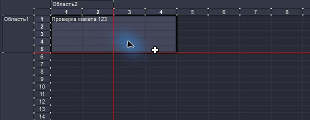
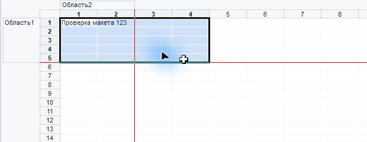

# Табличные документы и макеты

## Заголовки и сетка

На 1С 8.3.27.2325 x64 дефект воспроизведён в новом пустом табличном документе
отдельной файловой базы. При Dracula номера строк и колонок перекрывались
тёмными полосами независимо от новых значков и настройки шрифта.

Трассировка установила причину: платформа рисует градиент заголовков отдельными
RGB-полосами. Профиль заменял только `FCFAEB`, оставляя соседние полосы светлыми.
Добавлены точные привязки остальных оттенков нормальной рампы к `panel`,
активной рампы к `hover`, а сетки `E5E5E5` к `line`. Теперь профиль содержит
235 соответствий вместо 201. Геометрия, глифы и production-перехваты не менялись.

После пользовательской проверки дополнительно воспроизведены светлая заливка
выделения и нечитаемые подписи областей. Их источники отличаются от заголовков:
`cairo-rgb.D3D9EF` теперь использует `selection.background`; 11 оттенков рампы
`FAFAF2`–`FEFEF6`, `FFFFF7`–`FFFFFC` используют `panel`. Подписи и содержимое
ячеек сохраняют контраст с заливками. Остальные API-формы этих цветов не меняются.

Rust-регрессия проверяет все 22 оттенка, роли и контраст текста не ниже 4,5:1
во всех 13 темах. Native-регрессия рисует однопиксельные полосы через настоящий
Cairo и production IAT, затем проверяет пиксели и сетку, включая штатный режим.

## Значки

Добавлены 37 собственных SVG-мастеров для каждого набора: выравнивание и размер
объектов, текст, диаграмма, объединение ячеек, группировка, сетка, заголовки,
редактирование, фиксация, имена, примечания, границы, форматированная строка,
прозрачность и табличный документ. Для картинки используется существующий
`meta-image`. Все новые маски различаются по alpha, поэтому сохраняют
различимость при отрисовке через `cairo_mask_surface`.

Профиль `sheet-8.3.27.json` содержит 197 точных состояний, включая подготовленные
платформой неактивные варианты и размеры 14/16 px. В атласы добавлены 176 записей;
итоговый пакет содержит 538 ручных состояний и 814 записей атласов, всего 1352.
Нижние четыре строки динамических индикаторов цвета сохраняются.
Оригинальные пиксели ресурсов используются только для локальной проверки.

## Проверки и сборка

- Rust workspace: 52 core, 9 desktop и 4 CLI теста; Clippy без предупреждений.
- Frontend: svelte-check без ошибок/предупреждений, production bundle собран.
- Python: 12 тестов; 17 независимых golden-конфигураций согласованы.
- Native icon fixture, contrast_test и настоящий Cairo: успешно.
- 212 исходных поверхностей, оба набора и три Cairo API: 424 точные замены,
  сохранение соседних ячеек атласов, пропуск неизвестных поверхностей и mode off.
- Финальные GUI/CLI содержат текущие ThemeProbe.dll и FontProbe.dll побайтно;
  GUI subsystem проверен. Контрольные суммы лежат рядом с EXE.

Локальная сборка с исправленными областями и выделением:
`dist/mxl-areas-preview/v8-chroma.exe`. Предыдущая сборка остаётся в `dist/mxl-preview/`.
Это сборка разработки с production frontend, а не официальный релиз.
Исходники, диагностические инструменты и тестовая база не входят в EXE.

## Живая проверка и границы

В отдельной базе проверены пустой документ, ввод текста, сохранение и повторное
открытие MXL, светлая и тёмная темы, прокрутка, выключение и повторное включение
значков. Номера читаются, заполненная ячейка сохраняется. Финальная сборка
подключена к новому процессу: 25 перехватов, без предупреждения компонента значков.
Повторная проверка после исправления областей включает создание именованных
строк и колонок, сохранение MXL и выделение ячеек, строк и колонок. Подписи
`Область1`/`Область2` и текст ячейки читаются в Dracula и GitHub Light.
Регрессия настоящего Cairo проверяет пиксели рампы, заливку диапазона и
пропорциональные глифы Arial, а также сохранение источника после рисования.
При повторных CLI-применениях цветовая тема и значки обновились, затем компонент
шрифтов сообщил о несовпадении пути загруженной DLL. Это отдельное наблюдение;
полное повторное применение без этого сообщения здесь не подтверждено.
Рабочая ERP и запущенный пользовательский менеджер не изменялись.

Значок MDI-заголовка и кнопки окна документа в живом окне остаётся штатным:
добавление точных Cairo-ресурсов документа не покрывает этот путь отрисовки.
Замена системных значков окна требует отдельной реализации.
Живые проверки масштаба, печати и полной матрицы DPI
в этой итерации не выполнены. Они не заменяются проверкой 13 палитр.
Пользовательская проверка на реальном макете ERP пройдена.

Снимки тестового документа без рабочих данных:

Локальные диагностические скрипты, снимки и тестовые документы находятся
в игнорируемых `work/mxl-rendering/` и `evidence/mxl/`.
