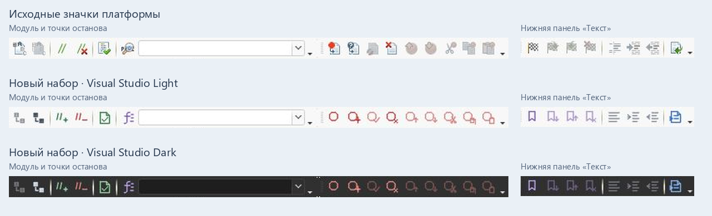

# Прототип собственных иконок конфигуратора

Эксперимент подключается отдельной `ToolbarIcons.dll` и выключен в обычной сборке.
Эксперимент сохранён для разработки. В основной сборке подмена теперь встроена
в ThemeProbe; GUI и CLI управляют ею через настройку `custom_icons`.



Предложение по включению в основной движок:
[icon-integration.md](icon-integration.md).

## Что найдено в установленной платформе

- `core83_root.res` (8.3) / `core85_root.res` (8.5): ZIP-контейнеры с PNG
  `tbglfile`, `tbgledit`, их вариантами размеров и отдельными старыми значками.
- `frame_root.res`: оформление, вспомогательные значки и полоски изображений.
- `config_root.res`: в том числе значки команд работы с хранилищем.

PNG `tbglfile_100.png` и `tbgledit_100_ltr.png` побайтно совпали в установленных
8.3.26.1656, 8.3.27.2325, 8.5.1.1529 и 8.5.4.1878. Это сравнение ресурсов,
а не подтверждение работы DLL на всех версиях.

В живом 8.3.27.2325 конфигуратор использует также отдельные старые PNG 16×16.
При подготовке прозрачности 1С отбрасывает дробную часть RGB×alpha/255,
а PNG-декодер Cairo округляет. Генератор учитывает оба варианта.

## Как устроена подмена

DLL перехватывает импорты `cairo_set_source`, `cairo_mask` и `cairo_mask_surface`
в `grphcs.dll`. Основной движок тем продолжает работать рядом. Для небольших
image surfaces, включая маски A8, вычисляется FNV-1a
по размерам и пикселям в формате premultiplied BGRA. Совпадение с `pack.tsv`
разрешает скопировать исходную поверхность и заменить заданный квадрат новым PNG.
Это работает как с отдельными значками, так и с фрагментами полосок.

Исходные пиксели, матрица, фильтр, режим повторения, device offset/scale сохраняются.
Незнакомые изображения проходят штатно. PDF, SVG и принтерные назначения исключены.
Результаты кэшируются, число уникальных изображений ограничено 1024.
Снимки небольших исходных поверхностей сохраняются в `observed/` внутри
экспериментального набора; статистика — по явной команде `snapshot`.

Пакет содержит только собственную графику и отпечатки. Извлечённые оригиналы
платформы находятся в игнорируемых `evidence/` и `work/` и не входят в поставку.

## Сборка и запуск

В Developer Shell с CMake, Ninja и выбранным C++ toolchain:

```powershell
cmake -S native -B build/native/toolbar-prototype -G Ninja -DCMAKE_BUILD_TYPE=Release -DV8_CHROMA_BUILD_ICON_PROTOTYPE=ON
cmake --build build/native/toolbar-prototype --target toolbar_icons toolbar_icons_test icon_test_graphics
python scripts/build_toolbar_prototype.py --platform 'C:/Program Files/1cv8/8.3.27.2325/bin'
```

При MinGW дополнительно передать `-DCMAKE_CXX_COMPILER=g++` и добавить его `bin`
в PATH. Для Python нужен Pillow (`scripts/requirements-branding.txt`).
SVG-мастера генерируются в `assets/toolbar-icons/dark/` и `light/`.
PNG, отпечатки и диагностические файлы находятся в `work/toolbar-icons/`.
Набор содержит 179 рисунков, активные и приглушённые варианты. Основные размеры —
14–64 px; дополнительные 8, 9, 12 и 15 px используются для мелких элементов.
Точные отпечатки текущей панели и состояния отключённых кнопок хранятся в
`assets/toolbar-icons/platform-8.3.27.json` (64 состояния), значки дерева — в
`assets/toolbar-icons/tree-8.3.27.json` (55 состояний). Контекстные и вложенные
меню описаны в `assets/toolbar-icons/menus-8.3.27.json` (34 состояния).
Остальные главные меню и панели редактора — в
`assets/toolbar-icons/editor-8.3.27.json` (65 состояний).
Генератор объединяет профили и отклоняет конфликтующие назначения.
Текущий пакет содержит 759 замен и 218 состояний в четырёх ручных профилях.

Использовать отдельный тестовый конфигуратор с пустой базой. Подставить его PID:

```powershell
python scripts/toolbar_icons_control.py start --pid 12345 --dll build/native/toolbar-prototype/bin/prototype/ToolbarIcons.dll --pack work/toolbar-icons/dark
python scripts/toolbar_icons_control.py snapshot --pid 12345 --dll build/native/toolbar-prototype/bin/prototype/ToolbarIcons.dll
python scripts/toolbar_icons_control.py stop --pid 12345 --dll build/native/toolbar-prototype/bin/prototype/ToolbarIcons.dll
```

Контроллер проверяет, что выбран именно `1cv8.exe DESIGNER`, и не подменяет
уже загруженную DLL с другим путём. `stop` восстанавливает импорт. Сам модуль
остаётся загруженным до завершения тестового процесса. Панель или меню может
потребовать перерисовки; новые версии DLL проверять в новом тестовом процессе.
Файлы установленной платформы не изменяются.

Светлый набор создаётся с `--style light --output work/toolbar-icons/light`.
Переключение набора: `stop`, затем `start` с другим `--pack`.
У светлого набора тёмные цветовые акценты и непрозрачность отключённых значков
62%; у тёмного — 42%. Толщина линий обоих наборов — 1.25 px в мастере 16×16.
После проверки светлого интерфейса приглушение усилено с 42% до 62%.
По предпочтению пользователя сохранён исходный тонкий контур.

Пользовательский путь с одной DLL, настройкой и выбором набора по теме описан в
[icon-integration.md](icon-integration.md). Старый ABI-v2 помощник
`preview_icon_theme.py` удалён: протокольные эталоны переведены на ABI v3.
Для интегрированной версии используйте CLI с отдельным профилем и явным PID;
не подключайте экспериментальную DLL одновременно с новым модулем значков.

## Проверено и ограничения

- Живой конфигуратор 8.3.27.2325: заменены все 30 видимых командных пиктограмм
  в группах «Стандартная», «Хранилище конфигурации» и «Конфигурация», а также
  стрелка и очистка поля поиска. Самостоятельной картинки у составной кнопки
  «Поиск» нет; её стрелка и крестик учтены отдельно.
- Проверены активные и неактивные состояния при переходе от пустого окна к
  новому текстовому документу. Создание открыло штатный диалог и документ.
- При открытии конфигурации и добавлении объекта платформа передаёт отдельные
  активные изображения хранилища, закрытия конфигурации и обновления базы.
  Эти варианты включены в профиль вместе с отключённым «Открыть конфигурацию».
- В панели дерева заменены добавление, изменение, копирование, удаление,
  перемещение вверх/вниз, сортировка и отбор по подсистемам. Проверены переходы
  между корнем дерева, разделом и выбранным объектом. В профиле 64 исходных
  состояния; команды поиска «следующий/предыдущий» сопоставлены с порядком UI.
- В развёрнутом дереве заменены значки типов метаданных, языка, реквизитов,
  табличных частей, форм, команд, макетов, нумераторов и последовательностей,
  а также стрелки раскрытия 9×9. Добавлены 50 рисунков метаданных. Проверены
  видимые строки справочника и документа с раскрытыми дочерними разделами.
- Контекстное меню справочника и документа: модули объекта/менеджера,
  предопределённые данные, добавление в расширение, стандартные реквизиты,
  характеристики, индексы, справка, оба направления поиска ссылок,
  «Дополнительно», свойства. Подменяются также значки в «Добавить» и
  «Конструкторы», включая отключённые конструкторы ввода на основании и движений.
- Меню дерева «Действия → Конфигурация»: сохранение, сравнение, отчёт,
  проверка, язык; просмотрены все шесть вложенных веток — конфигурация БД,
  поддержка, хранилище, поставка, мобильное приложение, рефакторинг.
  Просмотрена и третья ступень «Мобильное приложение → Использование Android
  Debug Bridge». Значки заменены там, где они есть в штатном меню; пункты
  мобильного приложения и рефакторинга в наблюдавшемся состоянии текстовые.
  Проверка хранилища выполнена без подключения: состояния после подключения
  требуют отдельного наблюдения. Команды изменения данных не выполнялись.
- Меню проверены в Visual Studio Light Modern, GitHub Light Default и
  Visual Studio Dark C++. Снимки и деревья доступности —
  `evidence/toolbar-icons/menus/`, итоговое сравнение — `menus-comparison.png`.
  Код DLL при этой доработке не менялся: расширены только собственные
  SVG-рисунки в `scripts/menu_icons.py` и точный профиль изображений.
- Остальные главные меню: «Файл», «Правка», «Текст», «Отладка»,
  «Администрирование», «Сервис», «Окна», «Справка» и дополнительные команды
  верхнего меню «Конфигурация». Просмотрены все видимые вложенные ветки:
  блок и группировка, рефакторинг и синхронные вызовы (третий уровень),
  варианты запуска отладки, служебные окна, интернет-справка,
  мобильный клиент и его Android Debug Bridge. Команды без штатных изображений
  остались текстовыми. Проверены также контекстное меню модуля, шаблоны и
  вложенный рефакторинг.
- Панели «Модуль», «Точки останова» и нижняя «Текст»: заменены все наблюдавшиеся
  командные пиктограммы. Добавлены противоположные состояния сворачивания всех
  групп и активные форматирование/отступы при выделении текста. Значок модуля
  в меню «Окна» использует отдельный отпечаток 14×14. Значки нативного заголовка
  дочернего окна и его вкладки остаются штатными: они вне перехвата Cairo.
  Текст модуля не редактировался; проверка доступности выполнялась выделением
  с последующим снятием выделения. Обработка состояния после запуска отладчика
  и дополнительные контексты других редакторов требуют отдельных наблюдений.
  Графика — `scripts/editor_icons.py`, снимки — `evidence/toolbar-icons/editor/`.
  Сравнения панелей и меню — `editor-panels-comparison.png` и
  `editor-menus-comparison.png` в том же каталоге. Финальный набор редактора
  проверен в Visual Studio Light Modern, GitHub Light Default и Visual Studio
  Dark C++; состояние выделения/без выделения не меняет текст модуля.
- Светлый набор проверен в живом конфигураторе в GitHub Light Default,
  Visual Studio Light Modern и стандартном оформлении платформы. Проверены
  верхняя панель, неактивные команды и дерево на белом фоне и выделении.
  Снимки: `evidence/toolbar-icons/tree-*-checked.jpg`, сравнение —
  `evidence/toolbar-icons/light-themes-comparison.png`. Цвета активных линий
  дают минимум 3.54:1 на пяти выбранных светлых фонах и фонах выделения;
  это расчёт для сплошного цвета, без сглаживания и приглушённых состояний.
- Нативный IAT-тест на настоящем Cairo: восемь размеров 14–64 px, замена фрагмента
  полоски с сохранением остальных пикселей, неизменность оригинала, матрица/фильтр/
  extend, штатная прозрачность рисования, маски A8 через оба mask-импорта,
  сохранение цвета рисования маски, пропуск незнакомых изображений, stop.
- Неверный пакет с выходом за каталог отклонён до установки перехвата.
- 8 Python-проверок проекта и 13 независимых протокольных эталонов прошли.

```powershell
python native/prototype/run_tests.py --cairo 'C:/Program Files/1cv8/8.3.27.2325/bin/cairo.dll' --build build/native/toolbar-prototype
```

Состав верхней панели и панели команд дерева в проверенных состояниях покрыт
целиком. Это не замена всех изображений платформы: команды, которые сейчас не
показаны, состояния подключённого хранилища, другие размеры или версии могут
потребовать дополнительных отпечатков. Профиль дерева покрывает наблюдавшиеся
значки, а новые виды дочерних объектов и их состояния могут потребовать расширения.
Одинаковые штатные изображения могут заменяться одновременно в панели и меню.
Маркеры переноса панелей, разделители и системные кнопки окна не являются
командными пиктограммами и остаются частью оформления. Светлая/тёмная графика
выбирается вручную.
Восемь размеров проверены программно; переключение DPI Windows в живом UI
и другие версии платформы пока не проверены.
